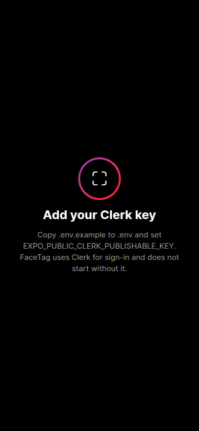

# FaceTag

FaceTag turns your face into a personal link card. You enroll once, choose what people can open, and anyone with the app can scan you the way they would scan a QR code.

It is an Expo Router app with Clerk for sign-in and a Neon Postgres API deployed as Vercel functions.

## What you can do

- Create an account with email or Google, including email verification and password reset
- Enroll your face from the camera. The server stores a signature, not the photo
- Set a public name, username, bio, photo, and the links you want to share
- Scan someone else and open their card in a result sheet
- Keep the profile private, remove the face signature, export your data, or delete the account
- Open a shared profile with `facetag://profile/[username]`

## Matching

With no extra keys, the API builds a lighting-tolerant face signature on the server. It is enough to tell enrolled faces apart in normal selfies. It is not ArcFace, so glasses, profile views, and poor light can miss.

For a stronger model, set `FACE_EMBEDDING_URL` to an endpoint that accepts `{ "imageBase64": "..." }` and returns `{ "embedding": [ ... ] }`. If `HUGGINGFACE_API_KEY` is set, the API uses that model instead (the current deployment uses CLIP). Embeddings from different engines are not compared with each other. After changing engines, people should re-enroll from Settings.

## Setup

1. Copy `.env.example` to `.env`.
2. Create a [Clerk](https://dashboard.clerk.com) application. Enable email/password and, if you want the Google button, the Google social connection. Put the publishable key in `EXPO_PUBLIC_CLERK_PUBLISHABLE_KEY` and the secret in `CLERK_SECRET_KEY` on the server.
3. Create a [Neon](https://neon.tech) database and run `api/_lib/schema.sql` in the SQL editor. Put the connection string in `DATABASE_URL`.
4. Deploy the `api/` folder to Vercel (`npm run deploy` or the Vercel dashboard) and set `EXPO_PUBLIC_API_URL` to that origin.
5. Install and start:

```bash
npm install
npm run dev
```

Open the project in Expo Go, an emulator, or the web build (`npm run web`).

## Scripts

| Command | What it does |
| --- | --- |
| `npm run dev` | Start Expo |
| `npm test` | Face-signature and profile unit tests |
| `npm run typecheck` | TypeScript |
| `npm run lint` | ESLint |
| `npm run export:web` | Static web bundle |
| `npx expo-doctor` | Expo SDK dependency check |
| `npm run deploy` | Production Vercel deploy |

## Screens

Splash, onboarding, sign in, sign up, face enrollment, profile setup, scanner, your profile, settings, a public profile, and in-app privacy and terms.

Until `EXPO_PUBLIC_CLERK_PUBLISHABLE_KEY` is set, the app stops on a setup screen instead of crashing:



## Privacy

Raw frames are not stored. The database keeps the signature, the profile you typed, and scan/view/click events. Private profiles are not returned from a scan. Settings can delete the signature or the whole account.
